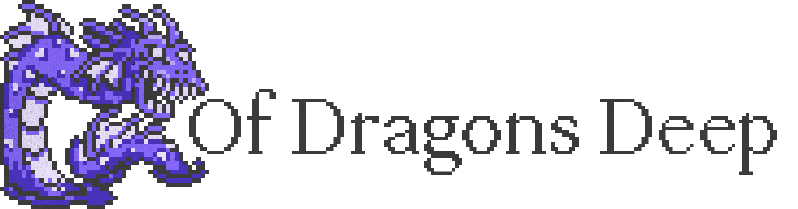

**Of Dragons Deep** is a fishing tracker. Yes, another one.

**Use it:** https://jadedzilla.github.io/of-dragons-deep/

Track the fish you've caught in Final Fantasy XIV and work toward the big fishing achievements.

## Run it

Requires [Node.js](https://nodejs.org) 18 or newer. No `npm install` needed — there are no dependencies.

```sh
npm run dev          # open http://localhost:5173
npm run fetch-data   # refresh the offline fallback data/fish.json
npm run fetch-icons  # refresh fish icons (data/icons/) from XIVAPI
npm run build        # single-file build at dist/index.html
```

Fish data is loaded live from the FFXIV Fish Tracker each time the app opens; a bundled snapshot is used if it can't be reached.

## Deploy

Every push to `main` builds the app and publishes it to GitHub Pages (`.github/workflows/pages.yml`).
One-time setup: **Settings → Pages → Build and deployment → Source: GitHub Actions**.

## Credits

Fish icons come from [XIVAPI](https://v2.xivapi.com/).
Fish data comes from the [FFXIV Fish Tracker](https://ff14fish.carbuncleplushy.com/) by Carbuncle Plushy.
FINAL FANTASY XIV © SQUARE ENIX CO., LTD.
